<div align="center">


<a href="https://github.com/Dems-dev">
  
</a>

<p>
  <a href="https://dems-dev.vercel.app"></a>
  <a href="https://www.linkedin.com/in/dhimasagung-dp/"></a>
  <a href="mailto:dhimasagung2004@gmail.com"></a>
  
</p>

</div>

<br/>

<div align="center">
  
</div>

<br/>

Computer Engineering Technology graduate (D4) from **IPB University**. By day I implement **Odoo 19** e-commerce; outside work I ship full-stack web apps and ESP32-based IoT systems, from the soldering iron all the way to a production deploy.

## ⚡ What I Bring

```diff
- Data scattered across dozens of Excel files
+ One integrated Odoo system, one source of truth

- Online orders re-typed manually into the warehouse
+ Website order → Sales → Inventory → Invoice, fully automated

- "Standard Odoo can't do that"
+ Clean, upgrade-friendly custom modules that fill the gap

- Water quality checked by hand, once a day
+ ESP32 → cloud database → live dashboard + Telegram alerts, every ~11 seconds

- Side projects that never leave localhost
+ Typed, tested, CI-checked apps running in production
```

## 💼 Experience

**IT Intern · PT Surya Sarana Dinamika** &nbsp;·&nbsp; <sub>via MagangHub · 2026 – present</sub>
- Implementing the company's e-commerce website on **Odoo 19** (Odoo.sh, Theme Alan), starting from process-flow documentation
- Rebuilt the `website_sale` product page in **QWeb** to match the Figma design, including a custom delivery-ETA field
- Handled staging database migration and backups of custom XML modules
- Compared payment gateways (Midtrans, Xendit, DOKU, Duitku, …) and shipping APIs (Biteship, RajaOngkir, KiriminAja, …) for integration
- Building a corporate executive summary from Odoo data for the internal IT dashboard

**Full Stack IoT Engineer (Internship) · BRMP Agroklimat dan Hidrologi Pertanian**
- Worked across the IoT stack: ESP32 firmware, cloud database, and web dashboard

**Freelance / Client Work**
- **SMARTURA**: smart electric terminal for an industrial client, built on ESP32 + Firebase with a usage-history dashboard
- **Toko Mantul Estu**: web-based inventory monitoring system with an AI chatbot for a retail store

## 🚀 Featured Projects

| Project | What it does | Built with |
| :-- | :-- | :-- |
| **SOLVA** | CRM for freelancers: clients, project pipeline, invoicing, and a public share-link portal. Multi-tenant, timezone-aware, E2E-tested in CI. **Live in production.** | Next.js 16 · PostgreSQL 17 · Prisma 7 · Better Auth · Playwright · GitHub Actions |
| **BantuIn** | Job-hunt companion I started for friends who were still looking for work: Kanban application tracker, ATS-friendly CV generator, fake-job checker via Telegram bot, psychometric test practice. | Next.js · TypeScript · Prisma · PostgreSQL (Supabase) · Auth.js · Vercel |
| [**Smart Aquaponix**](https://smart-aquaponix.vercel.app) | My D4 thesis: real-time pH and water-temperature monitoring for tilapia aquaponics. 915K+ clean sensor readings; the IoT pond reached 74% survival vs 50% in the conventional one. | ESP32 · DFRobot pH + ADS1115 · DS18B20 · Supabase · Next.js · Telegram Bot |
| **3D Physics Engine** | Rigid-body physics written from scratch and rendered on Canvas 2D: quaternions, inertia tensors, SAT collision detection, sequential impulse solver, orbit camera. | Canvas 2D API |
| **More IoT builds** | Hydro Smart Farm Dashboard and Water Quality Monitor for hydroponics and water-quality monitoring. | ESP32 · Firebase · Next.js |
| [**Daily Recap**](https://github.com/Dems-dev/daily-recap) | Personal daily-recap web app; every merge to `main` ships straight to Vercel. | Web app · Vercel |

## 🚧 Building in Public

Open-source Odoo 19 modules built for Indonesian businesses, one shipped at a time.

| Project | What it does | Status |
| :-- | :-- | :-: |
| [**odoo19-dev-docker**](https://github.com/Dems-dev/odoo19-dev-docker) | One-command Odoo 19 + PostgreSQL dev environment with backup & restore scripts |  |
| [**odoo-terbilang-id**](https://github.com/Dems-dev/odoo-terbilang-id) | Amount in Indonesian words (*terbilang*) on invoices & quotations |  |
| [**website-whatsapp-product**](https://github.com/Dems-dev/website-whatsapp-product) | "Order via WhatsApp" button on product pages, with product name & link |  |
| [**l10n-id-address**](https://github.com/Dems-dev/l10n-id-address) | Province → City → District dropdowns for contacts & website checkout |  |
| [**odoo-til**](https://github.com/Dems-dev/odoo-til) | Daily notes: ORM, QWeb, OWL & website tricks I learn on the job |  |

## 🛠️ Tech Stack

<div align="center">

**ERP**<br/>


<br/><br/>

**Web**<br/>


<br/><br/>

**IoT**<br/>


<br/><br/>

**Languages & Tools**<br/>


</div>

## 🎓 Education & Certifications

- **D4 (Sarjana Terapan) Teknologi Rekayasa Komputer**, IPB University, Sekolah Vokasi · graduated Aug 2026
  <br/><sub>Thesis: IoT for pH and water-temperature monitoring in a tilapia aquaponics system</sub>
- **Hardware Installation Supervisor**, BNSP certification via LSP IPB · 2026
- **Introduction to Cybersecurity**, Cisco Networking Academy · 2026

## 🐍 Contributions

<div align="center">
<picture>
  <source media="(prefers-color-scheme: dark)" srcset="https://raw.githubusercontent.com/Dems-dev/Dems-dev/output/github-snake-dark.svg?v=3"/>
  <source media="(prefers-color-scheme: light)" srcset="https://raw.githubusercontent.com/Dems-dev/Dems-dev/output/github-snake.svg?v=3"/>
  
</picture>
</div>

<br/>

<div align="center">

<i>"Good ERP is invisible — users just feel their work got easier."</i>


</div>
